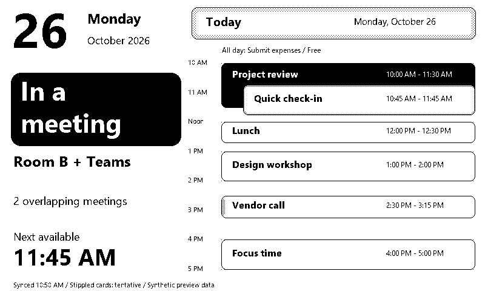

# ESP32 E-paper Display

A reusable e-paper display with separate calendar and dashboard page renderers.
The first live data source is Outlook: it synchronizes over Bluetooth Low Energy,
then runs from its saved schedule while the laptop is away. No Microsoft Graph,
Azure registration, TRMNL web service, cloud subscription, or Wi-Fi connection is
required. The laptop uses classic Windows Outlook through local COM/MAPI.

## Hardware variants

| Hardware | Firmware | Status |
| --- | --- | --- |
| Seeed TRMNL 7.5-inch (OG) DIY Kit, XIAO ESP32-S3 PLUS, 800x480 monochrome | [Seeed guide](firmware/seeed_trmnl/README.md) | Compiles; awaiting hardware validation |
| Inkplate 6COLOR, 600x448 color | [Inkplate guide](docs/inkplate.md) | Initial source; not compiled or hardware-tested |

The Seeed kit is the current development target. Its calendar page uses a date
and availability sidebar, a Today-only timeline with offset overlapping meetings, and a last-sync/battery footer.
The current client targets Seeed schema v4. The historical Inkplate sketch
remains on v3; use matching code from commit `2bd85e4` for that prototype.



The [page rendering layer](firmware/seeed_trmnl/ui/README.md) also includes a
separate read-only dashboard-card renderer for a future Home Assistant adapter.
The [dashboard design preview](previews/dashboard.png) uses synthetic data;
Home Assistant connectivity and dashboard message ingestion are not implemented.

## Architecture

- `sync_calendar.py` scans every 10 minutes. If the display is absent, it waits
  quietly without opening Outlook. When present, it authenticates the display,
  then reads today and tomorrow and sends up to 24 current/future events per day.
- `calendar_core.py` handles event selection, privacy redaction, UTC/local-time
  metadata, bounded AES-GCM encrypted packets, device authentication and BLE framing.
- The display proves possession of the per-device key using fresh client and
  device nonces. The client verifies this before opening Outlook. The schedule
  is encrypted end-to-end with AES-256-GCM, bound to that session. The display
  validates the complete packet, synchronizes its clock and stores
  the schedule in RTC-retained memory. It acknowledges the exact transaction ID.
- The radio turns off. The display wakes for meeting start/end boundaries,
  midnight, a morning sync window, a button press, or an optional NFC field detector. Overlapping meetings are
  handled, and omitted events create a knowledge cutoff rather than false free time.

**A sleeping display cannot receive BLE updates.** KEY1 opens a manual sync
window (default two minutes); a configurable morning window defaults to 12 minutes.
NFC field-detector wake, periodic BLE windows, all timers, event policies and
calendar viewport are configured in private `config.local.json`. Settings persist
on the Seeed and can be changed without reflashing. See the complete
[settings and NFC guide](docs/settings.md) and [credential-free example](settings.example.json).

One sync drives automatic status changes throughout the cached day and tomorrow.
Later edits in Outlook require another sync. A plain NFC sticker cannot wake the
panel; a wired field-detect output is required, and NFC hardware is not yet tested.

## Local software tests

Python 3.10+ is required. The synthetic dry run needs no extra packages. Tests
require the encryption library, but no Outlook, credentials, or Bluetooth hardware:

```powershell
python -m pip install -r requirements-test.txt
python -m unittest discover -s tests -v
python sync_calendar.py --dry-run
```

The dry run prints synthetic appointments only; it never reads Outlook or
transmits anything. `--demo --once` sends synthetic events over real BLE instead.

## Build the Seeed firmware on your personal computer

From this repository directory:

```powershell
python -m venv .build-env
.\.build-env\Scripts\python.exe -m pip install platformio==6.1.18
python provision.py --target seeed
.\.build-env\Scripts\python.exe -m platformio run -e seeed_trmnl
```

Provisioning generates matching `config.local.json` and
`firmware/seeed_trmnl/secrets.h`. Both are private and ignored by Git. It refuses
to replace existing credentials. Use a separate working copy for each display.
The [Seeed guide](firmware/seeed_trmnl/README.md) has pin assignments, upload steps,
power behavior and hardware acceptance checks.

Only source is published. Compiled firmware contains its device's credentials;
do not share the binary or generated credentials. CI uses disposable
per-run credentials and does not upload firmware artifacts.

## Set up the Windows laptop without administrator rights

Use classic desktop Outlook with the intended profile already configured. Copy
`sync_calendar.py`, `calendar_core.py`, `display_settings.py`, `requirements.txt`, `windows/`, and your
private `config.local.json` into a user-writable folder using an approved transfer
method. Firmware tools are not needed on that laptop.

In that folder:

```powershell
python -m venv .venv
.\.venv\Scripts\python.exe -m pip install -r requirements.txt
.\windows\Test-Environment.ps1 -PythonPath .\.venv\Scripts\python.exe
.\.venv\Scripts\python.exe sync_calendar.py --dry-run
```

No activation script is needed. If package downloads are blocked, use wheels
provided through your approved corporate package process. Outlook and Bluetooth
policy restrictions still apply; the code does not bypass them.

First test with synthetic events: press the display's sync button and run this
visibly so Windows can show its pairing dialog. Enter the PIN on the display:

```powershell
.\.venv\Scripts\python.exe sync_calendar.py --demo --once --pair
```

After confirming the agenda on the display, press its sync button again and run:

```powershell
.\.venv\Scripts\python.exe sync_calendar.py --once
```

Private and confidential appointment titles/locations are redacted unless
`--show-private` or `client.show_private` is enabled. Canceled and declined
appointments are excluded. Free all-day reminders are shown without marking you
busy; other free events are optional. Tentative, unanswered and working-elsewhere
entries conservatively block availability by default, with configurable policies.
Accepted/tentative RSVP, Teams/physical/hybrid venues and all-day flags remain
separate metadata. Recurrences and appointments spanning midnight are included. Outlook must
have the relevant cached calendar data; the client does not force server sync.

`--once` exit codes: 0 accepted, 1 extraction/connection/transfer failure,
2 configuration/dependency failure, 3 display not found. Logs omit event content.
For multiple displays, restrict discovery with `--address AA:BB:CC:DD:EE:FF` or an
`"address"` field in `config.local.json`.

## Quiet startup at Windows logon

After foreground pairing and validation:

```powershell
.\windows\Register-CalendarTask.ps1 -PythonwPath .\.venv\Scripts\pythonw.exe -WhatIf
.\windows\Register-CalendarTask.ps1 -PythonwPath .\.venv\Scripts\pythonw.exe
Start-ScheduledTask -TaskName 'Inkplate Calendar Sync'
```

The default task name retains the original Inkplate name but works with either
board. It can be changed using `-TaskName`. The task uses your logged-in session,
limited privileges and `pythonw.exe`; it writes a rotating `sync.log` in the
project folder. If task registration is blocked, launch the same client manually.
To stop/remove the default task:

```powershell
Stop-ScheduledTask -TaskName 'Inkplate Calendar Sync'
Unregister-ScheduledTask -TaskName 'Inkplate Calendar Sync'
```

## Validation and limits

The Seeed firmware compiles with pinned dependencies in `platformio.ini`.
Automated tests cover calendar selection, privacy, packet sizes/authentication,
framing, provisioning, mocked Outlook extraction and BLE acknowledgements. The
[CI workflow](.github/workflows/checks.yml) runs Python tests on Windows and Linux
and builds the Seeed firmware. Windows also exercises native regional date APIs.

**Not yet verified on physical hardware:** panel compatibility/rendering,
Windows pairing and bonded reconnect, internal clock drift, button/NFC wakes, and
actual sleep current/battery life. Full refreshes are used initially. Timing is
subject to clock drift, boot time and panel refresh; visible changes are not
promised to be instantaneous. A power loss can leave the last image on e-paper.

The two-day calendar uses semantic schema v4 inside the existing encrypted v2
transport, with a 4,096-byte packet limit. Update the client and firmware together.
The Seeed receiver also accepts v2/v3 calendar data; no plaintext-v1 fallback is allowed.
Existing per-device keys can be reused;
do not overwrite or publish the generated credential files.

Both variants are independent of Home Assistant. Future integrations can produce
the same [BLE protocol](PROTOCOL.md) without changing the Windows calendar reader.
See the [Home Assistant integration plan](docs/home-assistant.md) for the native
card/dashboard and availability integration paths.

## License

Project source is under the repository's [MIT license](LICENSE). Third-party
libraries retain their own licenses; dependency sources are downloaded by the
build rather than copied into this repository.
